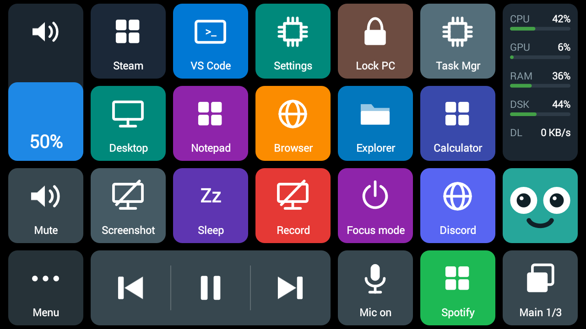
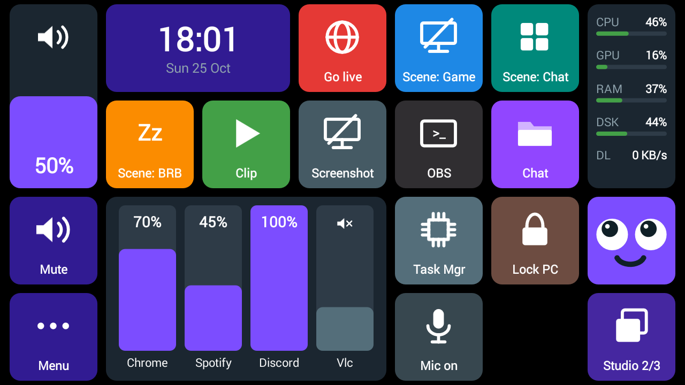
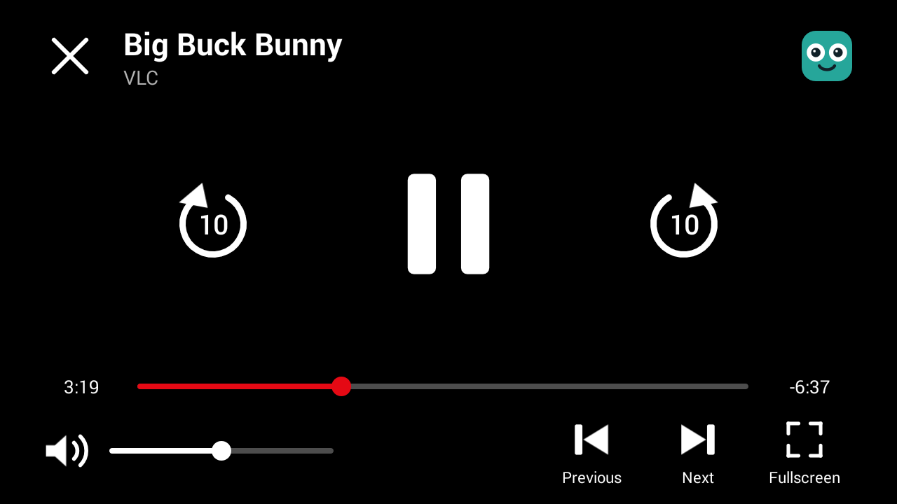
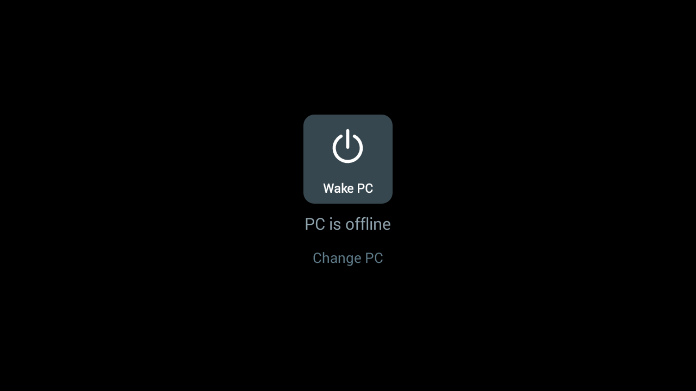
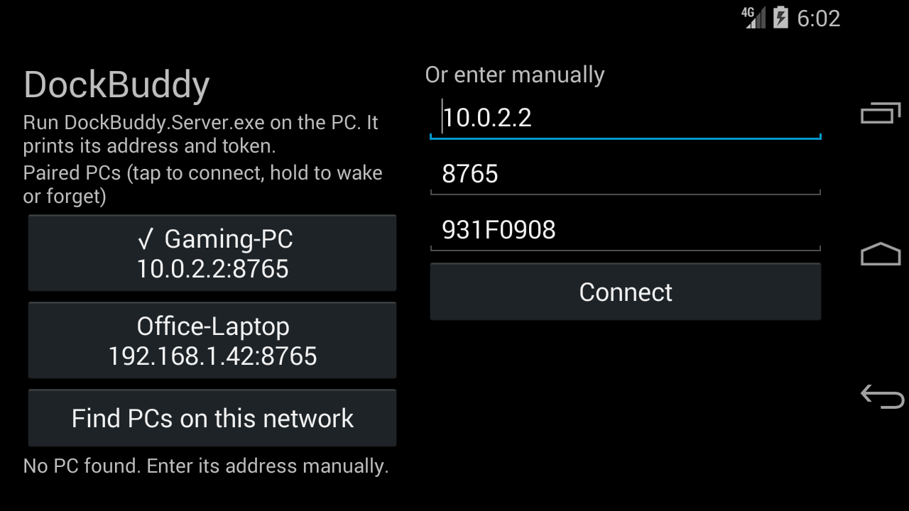

# DockBuddy

**Turn any old Android phone or tablet into a Stream Deck for your Windows PC.**

DockBuddy is a grid of big, colorful buttons that launch apps, run commands and scripts, press hotkeys, control media and volume, and show live PC stats. A small companion app on the PC does the work. It runs on Android 4.0 and newer, so that phone in your drawer finally has a job.



## Highlights

- **Buttons for everything:** open programs, files, folders and URLs; run commands and scripts (`.ps1`, `.bat`, `.cmd`, `.py`); send hotkeys and media keys; lock, sleep, restart or shut down the PC.
- **Macros and toggles:** one tap runs several actions in a row, with waits in between. A toggle switches between two actions and two looks, for example *Record* and *Stop*.
- **Widgets:** a volume fader, mute, microphone mute, a per-app **audio mixer**, media controls, a system monitor (CPU, GPU, RAM, VRAM, disk, network), a clock, and a friendly mascot. Every widget can be moved, resized, recolored or hidden, separately on each page.
- **Pages that follow you:** tie a page to a program and the phone switches to it when that program comes to the front, for example a game, OBS or Photoshop.
- **Popcorn mode:** a Netflix-style remote for whatever video is playing. It is offered automatically when a video goes fullscreen.
- **Designed on the PC:** lay out the deck in a drag-and-drop editor on the PC. The phone picks up changes within two seconds.
- **Share pages:** export a page, including its custom icons, to a single `.dbpage.json` file, and import pages from others.
- **Wake-on-LAN:** if the PC is off, the phone shows a big *Wake PC* button.
- **Updates itself:** the PC carries the phone app and offers newer versions to the phone automatically.

## Screenshots

| | |
|---|---|
|  **Main deck:** buttons plus volume, mute, mic, media controls and the system monitor |  **A streaming page:** clock, per-app audio mixer, toggle and scene buttons, in its own colors |
|  **Popcorn mode:** play/pause, ±10 s, scrubbing, volume, previous/next and fullscreen |  **PC offline:** wake it from the phone |
|  **Pairing:** finds PCs on the network and remembers every PC it has paired with | |

## Getting started

You need a Windows 10 or 11 PC and an Android 4.0+ phone or tablet, both on the same Wi-Fi or LAN.

### 1. On the PC

1. Download `DockBuddy.Server.exe` from the [Releases](../../releases) page, or [build it](#building).
2. Run it. No installation is needed. A small window shows the PC's address and a pairing **token**.
3. Allow it through Windows Firewall when asked: TCP 8765 for the app, and UDP 8766 so the phone can find the PC. You can also add the rules from an admin prompt:
   ```
   netsh advfirewall firewall add rule name="DockBuddy" dir=in action=allow protocol=TCP localport=8765
   netsh advfirewall firewall add rule name="DockBuddy discovery" dir=in action=allow protocol=UDP localport=8766
   ```
4. Optional: tick **Start with Windows**. Closing or minimizing the window sends DockBuddy to the system tray, where it keeps running.

### 2. On the phone/tablet

1. Install `DockBuddy.apk` from the Releases page. You'll need to allow installing apps from unknown sources.
2. Open DockBuddy. It searches the network for the PC. Tap the PC, enter the token, and connect.

That's it. The default deck has a Main page and a System page to start from.

## Editing the deck

Everything is edited on the PC: open the DockBuddy window and click **Edit layout…**. The phone never edits the layout, so all your phones and tablets show the same deck.

- **Buttons:** click a free cell to add a button, click a button to edit it, and drag a button to move it. Drop it on another button to swap them.
- **Widgets:** drag a widget to move it, click it to change its size, color and options, or remove it. Click a free cell to bring back a removed widget.
- **Pages:** add, rename and delete pages. To show a page automatically, pick a program under *Show this page automatically when this app is in front*. The list includes everything installed on the PC.
- **Share:** **Export…** saves the current page to a file. **Import…** adds a page from a file. Before importing, DockBuddy lists what the page's buttons can do, for example run commands or open programs.

### Button actions

| Type | Value | Examples |
|------|-------|----------|
| `open` | program, file, folder or URL | `notepad.exe`, `https://example.com`, `steam://open/main` |
| `command` | command line (run with `cmd /c`); the output is shown on the phone | `ipconfig /all` |
| `script` | path to a script on the PC | `C:\scripts\backup.ps1` |
| `keys` | keys joined with `+` | `ctrl+shift+esc`, `win+d`, `win+alt+r`, `media_play_pause`, `f5` |
| `system` | `lock` `sleep` `hibernate` `screenoff` `shutdown` `restart` `logoff` | |
| `volume` | `up` `down` `mute` `unmute` `toggle-mute`, a level `0-100`, or `mic-mute` `mic-unmute` `mic-toggle` | |
| `media` | `playpause` `next` `prev` `seek:-10` `seek:+10` `seekto:123` | acts on the app that is playing |
| `macro` | a list of the actions above, each with an optional wait | |

Any button can be made a **toggle** by giving it a second state.

### Widgets

| Widget | What it does |
|--------|--------------|
| Volume slider | PC master volume; becomes horizontal when wider than tall |
| Mute / Microphone mute | toggles speakers or mic; turns red while muted |
| Audio mixer | one fader per program playing audio; tap a fader to mute it |
| Media controls | previous / play-pause / next in one tile |
| System monitor | CPU, GPU, RAM, VRAM, disk, network, GPU temperature; shows more rows when taller; tap it for the full-screen monitor |
| Clock | time and date, 12/24 h, optional seconds |
| Profile | shows the current page; tap to switch to the next page |
| Settings | the app menu: Popcorn mode, PC monitor, Wake PC, Check for update, Change PC |
| Mascot | a little face whose eyes follow your finger and who cheers when a button works |

Want your own? A widget is one class on the phone plus one line on the PC. See [docs/WIDGETS.md](docs/WIDGETS.md).

## More features

- **Video detection:** the PC combines Windows' "now playing" media session with the foreground window to tell when a video is playing, and only offers Popcorn mode when it is fullscreen. This needs Windows 10 1903 or newer.
- **GPU monitoring:** load and video memory work for NVIDIA, AMD and Intel through Windows' performance counters. GPU temperature appears when NVIDIA's `nvidia-smi` is installed.
- **Wake-on-LAN:** the phone learns the PC's network card address while the PC is on. Waking also needs Wake-on-LAN turned on in the PC's BIOS/UEFI and network card settings, and works best over a wired connection.
- **Remote update:** `DockBuddy.Server.exe` contains the matching phone app. When the phone connects to a PC with a newer version, it offers to update. **Menu → Check for update** does the same on demand.
- **Multiple PCs:** the phone remembers every PC it has paired with. Switch PCs under **Menu → Change PC**.

## Security

DockBuddy runs commands on your PC for anyone who has the pairing token. Traffic uses **plain HTTP** on your local network.

- Only use it on networks you trust, and keep the token private. Delete `config.json` next to the exe to create a new token.
- Never forward its ports to the internet.
- Only import pages from people you trust. The import dialog tells you what a page's buttons can do before you accept it.

## Building

```
# Android app (JDK 17 and Android SDK 34)
cd android
./gradlew assembleDebug          # -> app/build/outputs/apk/debug/app-debug.apk

# Windows server (.NET 8 SDK; can be cross-built from Linux or macOS)
cd server/DockBuddy.Server
dotnet publish -c Release -r win-x64 --self-contained -p:PublishSingleFile=true \
  -p:IncludeNativeLibrariesForSelfExtract=true -p:EnableCompressionInSingleFile=true -o ../publish
```

To ship the phone app inside the server for remote updates, copy the APK to `dist/DockBuddy.apk` *before* publishing the server. Raise `versionCode` in `android/app/build.gradle` for every release you want phones to pick up. Updates must be signed with the same key as the installed app.

For trying things out without Windows, `dotnet run -p:Headless=true -- --dev` starts the server with no window and stand-in audio, media and PC stats, so the phone app and the HTTP API can be used from Linux or macOS.

### Project layout

```
android/          Android app (Java, minSdk 14, no AndroidX, everything drawn in code)
server/           Windows companion (.NET 8, ASP.NET Core minimal API + WinForms tray app)
docs/WIDGETS.md   how to write a custom widget
```

Settings live next to the exe: `config.json` holds the name, port and token, `deck.json` holds the page order, `pages/*.json` holds one file per page, and `icons/` holds custom button images.